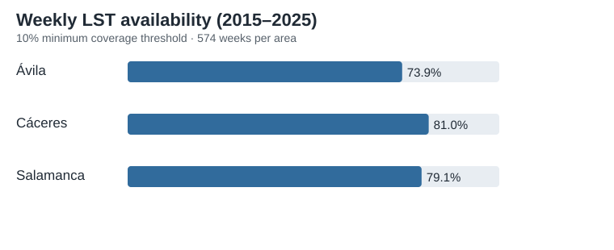
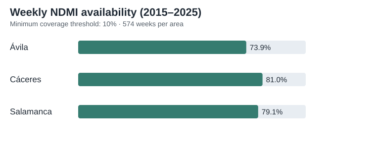
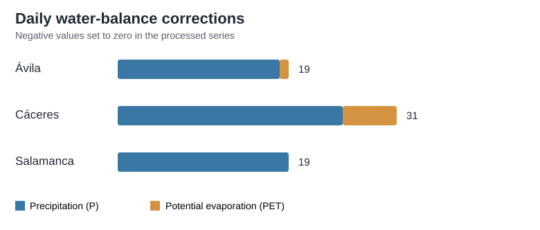

# Remote Sensing Drought and Heat Indicators

Python workflows for NDMI, land surface temperature (LST), and climatic water balance using Landsat 8/9, ERA5-Land, and Google Earth Engine.

The supplied scripts cover areas labelled Salamanca, Avila and Caceres, mainly over 2015–2025.

- **NDMI/NDVI:** Landsat extraction, exploratory quality diagnostics and 14-day weekly windows.
- **LST:** daily mosaics, weekly 90th percentiles, coverage sensitivity and internal consistency checks.
- **Water balance:** ERA5-Land precipitation and potential evaporation, rolling 30/60/90-day balances, resumable downloads and arithmetic checks.

See [methodological notes](docs/methodology.md) for scientific and technical limitations.

## Requirements

Install packages listed in `requirements.txt`. Google Earth Engine scripts require an authorized Earth Engine project and accessible geometries; original asset identifiers and some local Windows paths need configuring.

## Observed LST outputs (2015–2025)

The following **aggregated values come from the author's actual CSV outputs** (uploaded October 2026), not from synthetic examples. Original CSVs are **not** published in this repository. These are workflow and arithmetic quality checks, not independent validation of satellite surface temperature.

At the **10% minimum coverage threshold**, the weekly output contains 574 Sunday windows for each of three study areas:

| Area | Available weeks | Availability | Available weeks with one qualifying day | Missing weeks |
|---|---:|---:|---:|---:|
| Ávila | 424 / 574 | 73.9% | 188 | 150 |
| Cáceres | 465 / 574 | 81.0% | 195 | 109 |
| Salamanca | 454 / 574 | 79.1% | 235 | 120 |
| **Total** | **1,343 / 1,722** | **78.0%** | **618** | **379** |

The daily LST mosaic output has **1,476 records**. The definitive weekly output has **1,722 records** (including missing weeks). Sensitivity analysis considered coverage thresholds of **5%, 10% and 20%**.

### Recorded quality-control findings

- **0** invalid daily dates, invalid weekly dates, duplicate daily or weekly keys, out-of-range coverage fractions, or discrepancies in weekly recalculation.
- **0** discrepancies against the original sensitivity summary; the two supplied sensitivity-summary CSVs agree.
- **688** instances where valid area exceeded total area beyond the script's **0.1% tolerance**. This is a geometric/scale concern requiring investigation; fractions reported within [0, 1] do **not** resolve it.
- **4** flagged daily temperatures above 55 °C passing the 10% coverage threshold, all in Salamanca. The extreme-temperature audit also lists three subzero values in Ávila that **do not** pass that threshold. Flags indicate review, not automatic invalidation.
- **618** weekly values at 10% coverage derive from **only one qualifying day**; interpret their 90th-percentile label cautiously. **379** weekly windows have no qualifying observations; missing values should not be treated as zero.

**Source files examined locally:** `01_LST_diario_mosaico.csv`, `01_LST_semanal_definitivo_2015_2025.csv`, `02_LST_semanal_sensibilidad.csv`, `02_resumen_sensibilidad_validado.csv`, `03_incidencias_recalculo.csv`, `03_resumen_sensibilidad(1).csv`, `04_cobertura_anual.csv`, `05_cobertura_mensual.csv`, `06_temperaturas_extremas_diarias.csv`, `07_controles_validacion.csv`, and `08_coincidencia_semanal_NDMI_LST.csv`. No individual observations or private geometries are included here.

## Observed NDMI outputs (2015–2025)

The following aggregated figures are computed from **actual author-provided NDMI CSV outputs**, not synthetic examples. Original CSV files are **not** published here.

With a **10% minimum coverage threshold**, the weekly NDMI output covers 574 Sunday windows per area:

| Area | Available weeks | Availability | Available weeks with one qualifying day | Missing weeks |
|---|---:|---:|---:|---:|
| Ávila | 424 / 574 | 73.9% | 188 | 150 |
| Cáceres | 465 / 574 | 81.0% | 195 | 109 |
| Salamanca | 454 / 574 | 79.1% | 235 | 120 |
| **Total** | **1,343 / 1,722** | **78.0%** | **618** | **379** |

The daily NDMI mosaic file contains **1,476 records**; the definitive weekly file contains **1,722 records**, including weeks with missing NDMI. Weekly NDMI is the **minimum value over a 14-day lookback window**, not a weekly average. In **618** available weeks only one qualifying day contributes; missing weeks are not zeros.

### Sensitivity to minimum coverage

| Area | 5% threshold | 10% threshold | 20% threshold |
|---|---:|---:|---:|
| Ávila | 428 / 574 | 424 / 574 | 416 / 574 |
| Cáceres | 469 / 574 | 465 / 574 | 459 / 574 |
| Salamanca | 461 / 574 | 454 / 574 | 428 / 574 |

### Recorded quality checks

- The supplied recalculation-incidents file has **zero rows**, and the validation-alerts file has **zero rows**. These checks do not establish independent scientific validation.
- No duplicate area/date keys were found in the daily NDMI file.
- No daily NDMI record has `valid_area_m2 > total_area_m2`; the recorded coverage fraction ranges from **0 to 1**.
- The availability counts at the 10% threshold happen to match the LST series, but this does **not** mean that NDMI and LST values, observations or methods are interchangeable.

**Source files inspected locally:** `01_NDMI_diario_mosaico(1).csv`, `01_NDMI_semanal_definitivo_2015_2025(1).csv`, `02_NDMI_semanal_sensibilidad(1).csv`, `02_resumen_sensibilidad_validado(2).csv`, `03_resumen_sensibilidad(2).csv`, `03_incidencias_recalculo(2).csv`, `04_cobertura_mensual(1).csv`, and `05_alertas_validacion(1).csv`. No individual records or private geometries are included.

## Observed climatic water-balance outputs (2014–2025)

The following are **aggregated results from the author's original CSV outputs**, not simulated data. The original CSVs and individual observations are **not published** in this repository.

The daily series covers **1 October 2014–31 December 2025** and contains **12,330 area-day records** (4,110 days for each area). The definitive weekly series spans **574 Sundays per area in 2015–2025**, totaling **1,722 weekly records**, with rolling **30-, 60-, and 90-day** climatic water balances in millimetres.

The underlying definition is **WB = P − PET**, where P is ERA5-Land precipitation and PET is ERA5-Land potential evaporation. **ERA5-Land PET is not FAO-56 reference evapotranspiration (ET0).**

### Documented daily corrections

The processing audit records **69 negative input values set to zero**, retaining the originals in separate columns in the private processed dataset:

| Area | Negative P values corrected | Negative PET values corrected | Total |
|---|---:|---:|---:|
| Ávila | 18 | 1 | 19 |
| Cáceres | 25 | 6 | 31 |
| Salamanca | 19 | 0 | 19 |
| **Total** | **62** | **7** | **69** |

The decision to clip negative precipitation or PET values to zero is an **operational processing rule**; it should not be interpreted as independent evidence that every original ERA5-Land value was physically erroneous.

### Sensitivity of weekly rolling balances

The validation summary reports the number of weekly windows with a non-zero difference between the original and corrected series, and the maximum absolute change in each area:

| Area | Changed WB30 weeks | Changed WB60 weeks | Changed WB90 weeks | Maximum absolute change (mm) |
|---|---:|---:|---:|---:|
| Ávila | 70 | 125 | 180 | 0.150561 |
| Cáceres | 125 | 228 | 316 | 0.073993 |
| Salamanca | 74 | 140 | 200 | 0.000026 |

The counts are **per rolling window**, not distinct correction events. A correction to one day can affect multiple subsequent 30-, 60-, or 90-day windows. The maximum absolute change in the validation summary is **0.150561 mm**, in Ávila.

### Quality-control interpretation

- The definitive daily file has **no missing P, PET or WB values**, and the definitive weekly file contains all **1,722 expected area-week records**.
- The recalculation-incidents CSV contains **zero incident rows**; this documents internal arithmetic consistency, **not independent meteorological validation**.
- The preliminary controls report **no missing daily P/PET values**. They also report seven negative PET values, while the later correction log documents 62 negative P and seven negative PET corrections. These controls describe **different processing stages** and should not be treated as contradictory without reviewing the preprocessing pipeline.
- The original and corrected values are preserved in the author's private daily dataset; only aggregated counts and sensitivity measures are shown here.

**Author-provided source files reviewed:** `01_WB_diario_2014_2025.csv`, `01_WB_diario_depurado_2014_2025.csv`, `02_WB_semanal_2015_2025_prevalidacion.csv`, `02_WB_semanal_definitivo_2015_2025.csv`, `03_controles_preliminares.csv`, `03_correcciones_diarias.csv`, `04_sensibilidad_correcciones_semanales.csv`, `05_resumen_validacion.csv`, and `06_incidencias_recalculo.csv`.

## Data and validation

No raw data, private Earth Engine assets, synthetic results or fabricated figures are included. The uploaded scripts have not been executed against the original data as part of this repository setup. ERA5-Land potential evaporation is **not** FAO-56 ET0; the scripts' internal checks are not independent validation.
